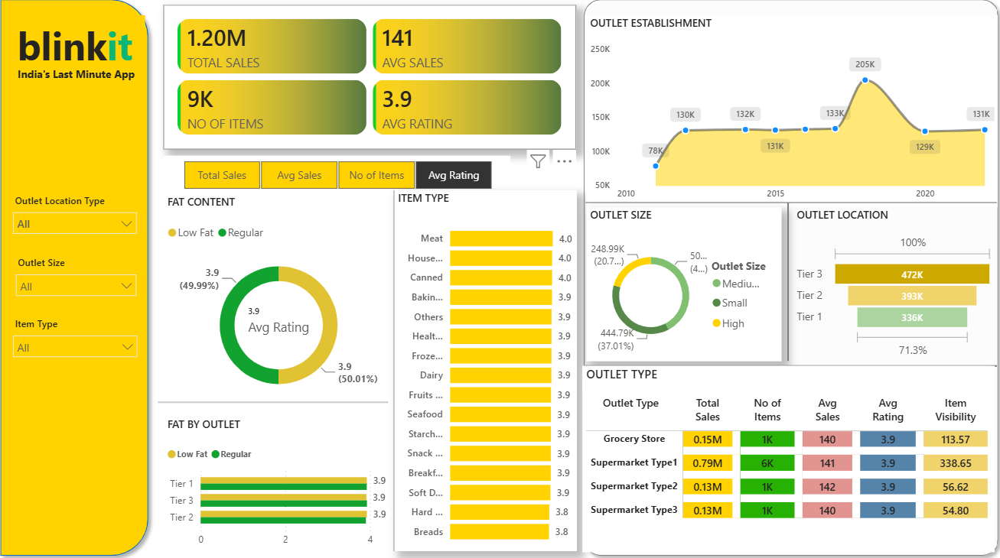

# 🛒 Blinkit Sales Analysis — Power BI, SQL & Python (Google Colab)

An end-to-end data analytics and business intelligence project exploring sales performance, customer satisfaction, outlet characteristics, and inventory distribution for **Blinkit** using **Power BI**, **SQL**, and **Python (Google Colab)**.

---

## 🖼️ Dashboard Preview



---

## 📁 Project Structure

```text
Blinkit_Sales_Analysis/
│
├── Dashboard/
│   ├── BLINKIT_GROCERY_DASHBOARD.pbix # Interactive Power BI dashboard file
│   └── dashboard_screenshot.png       # Preview image of the dashboard
│
├── Dataset/
│   └── BlinkIT_Grocery_Data.csv       # Raw grocery sales dataset (8,523 records)
│
├── Google Colab/
│   └── Blinkit_Analysis.ipynb         # Python data analysis & visualizations
│
├── SQL/
│   └── analysis_queries.sql           # SQL queries for schema, cleaning & KPIs
│
├── .gitignore                         # Git ignore configuration
└── README.md                          # Project documentation
```

---

## 📊 Dataset Overview

The dataset (`Dataset/BlinkIT_Grocery_Data.csv`) contains **8,523 transactions** across **12 attributes** reflecting quick-commerce grocery retail operations:

| Column Name | Data Type | Description |
| :--- | :--- | :--- |
| `Item Fat Content` | Categorical | Fat level (`Low Fat`, `Regular`) — standardized from raw entries (`LF`, `reg`) |
| `Item Identifier` | Categorical | Unique item identification code (e.g., `FDX32`, `NCB42`) |
| `Item Type` | Categorical | Product category (Fruits & Vegetables, Snack Foods, Dairy, etc.) |
| `Outlet Establishment Year` | Integer | Store launch year (ranging from 2011 to 2022) |
| `Outlet Identifier` | Categorical | Unique store identifier (e.g., `OUT049`, `OUT018`) |
| `Outlet Location Type` | Categorical | City tier classification (`Tier 1`, `Tier 2`, `Tier 3`) |
| `Outlet Size` | Categorical | Store physical scale (`Small`, `Medium`, `High`) |
| `Outlet Type` | Categorical | Store business model (`Supermarket Type1/2/3`, `Grocery Store`) |
| `Item Visibility` | Decimal | Ratio of total display area allocated to the product |
| `Item Weight` | Decimal | Product weight in kilograms |
| `Sales` | Decimal | Total revenue generated by the item transaction |
| `Rating` | Decimal | Customer satisfaction rating (1.0 to 5.0) |

---

## 🎯 Key Performance Indicators (KPIs)

- **Total Sales**: Overall revenue generated (**~$1.20M**)
- **Average Sales**: Mean transaction value (**~$141 per transaction**)
- **Number of Items Sold**: Total item transaction records (**8,523 items**)
- **Average Rating**: Customer satisfaction score (**~3.9 / 5.0 ⭐**)

---

## 🔍 Analytical Breakdown

### 1. Python Analysis (`Google Colab/Blinkit_Analysis.ipynb`)
The Jupyter Notebook utilizes **Pandas**, **NumPy**, **Matplotlib**, and **Seaborn** to explore:
- **Data Cleaning & Standardization**: Normalizing inconsistent labels in `Item Fat Content` (`LF`, `low fat`, `reg`).
- **Total Sales by Fat Content**: Comparing consumer demand for Low Fat vs. Regular products.
- **Total Sales by Item Type**: Identifying top-performing categories (Fruits & Vegetables, Snack Foods, Dairy).
- **Fat Content by Outlet Location**: Cross-tabulating sales by fat content across city tiers.
- **Establishment Year Trends**: Tracking revenue growth across store inception years.
- **Outlet Size & Location Analysis**: Measuring sales share across Small, Medium, and High store footprints.

### 2. SQL Analysis (`SQL/analysis_queries.sql`)
The SQL suite includes 14 structured queries:
- **DDL Table Definition**: Schema creation for `blinkit_grocery`.
- **Data Cleaning**: `UPDATE` queries standardizing categorical fat content entries.
- **Top-Level KPI Metrics**: Summary aggregations for Total Sales, Average Sales, Order Count, and Average Rating.
- **Granular Groupings**: Multi-level aggregations by outlet size, outlet type, location tier, and product category.
- **Matrix Calculations**: Pivot calculations comparing fat content revenue across outlet location types.

### 3. Power BI Dashboard (`Dashboard/BLINKIT_GROCERY_DASHBOARD.pbix`)
Interactive business intelligence dashboard featuring:
- **KPI Summary Cards**: Real-time sales, order counts, and satisfaction scores.
- **Dynamic Slicers**: Interactive filtering by Outlet Location Tier, Outlet Size, and Item Type.
- **Visual Analytics**:
  - Donut & bar charts for sales by fat content.
  - Category-level sales rankings.
  - Outlet growth trajectory line charts.
  - Outlet size distribution matrices.

---

## 🛠️ Tech Stack

- **Business Intelligence**: Microsoft Power BI Desktop
- **Programming & Analysis**: Python (Google Colab / Jupyter Notebook)
  - `pandas`, `numpy`, `matplotlib`, `seaborn`
- **Database Querying**: SQL (SQLite, MySQL, PostgreSQL compatible)

---

## 🚀 How to Use

### 1. Power BI Dashboard
1. Open [Dashboard/BLINKIT_GROCERY_DASHBOARD.pbix](Dashboard/BLINKIT_GROCERY_DASHBOARD.pbix) in **Power BI Desktop**.
2. Refresh data source connection pointing to `Dataset/BlinkIT_Grocery_Data.csv` if needed.
3. Explore the visual charts, cross-filtering, and dynamic slicers.

### 2. Google Colab / Jupyter Notebook
1. Open [Google Colab/Blinkit_Analysis.ipynb](Google Colab/Blinkit_Analysis.ipynb) in **Google Colab** or Jupyter Notebook.
2. Ensure `Dataset/BlinkIT_Grocery_Data.csv` is uploaded or placed in the working directory.
3. Run the cells sequentially to reproduce the exploratory data analysis and charts.

### 3. SQL Queries
1. Open [SQL/analysis_queries.sql](SQL/analysis_queries.sql) in your preferred SQL client (DBeaver, MySQL Workbench, pgAdmin, SQLite).
2. Execute the DDL table script and import `Dataset/BlinkIT_Grocery_Data.csv`.
3. Run the KPI and breakdown queries to generate analytical reports.
